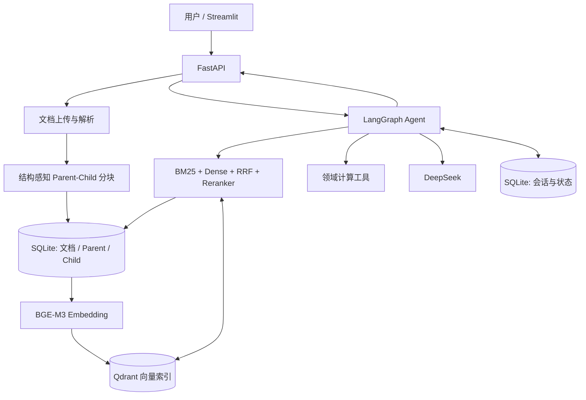

# GeoHydro-Energy RAG Agent

**面向地质灾害、水文气象与新能源技术文档的 RAG + LangGraph 智能问答系统**  
*A domain-oriented retrieval-augmented generation and agentic document assistant.*

[](https://www.python.org/)
[](https://github.com/langchain-ai/langgraph)
[](https://qdrant.tech/)
[](https://fastapi.tiangolo.com/)
[](https://docs.docker.com/compose/)

> **项目状态**：可在本地通过 Docker Compose 部署并运行。复杂文档解析和跨文档、多方面问题的检索效果仍在持续评估。仓库不包含私有 API Key、模型权重、向量数据库运行数据或原始第三方 PDF。

## 项目简介

地质灾害、水文气象和新能源领域的技术规范、算法说明及研究报告篇幅长、术语密集，使用传统关键词检索难以同时获得相关性和完整上下文。本项目将多格式文档解析、混合检索、结构化上下文展开和工具调用整合为可交互的 RAG Agent，支持用户基于自己的技术文档进行问答，并追踪答案的来源文件、页码等信息。

项目包含 **FastAPI 后端、Streamlit 前端、Qdrant 向量数据库、SQLite 持久化**，通过 Docker Compose 组织部署，侧重从原型到可维护系统的工程实现。

## 功能概览

| 模块 | 已实现能力 |
| --- | --- |
| 文档处理 | PDF、DOCX、TXT、Markdown 解析；批量上传；进度反馈；SHA256 去重 |
| 结构化分块 | 文档结构识别、Parent–Child 切片，Child 负责索引、Parent 提供较完整上下文 |
| 混合检索 | BGE-M3 Embedding + Qdrant Dense Retrieval + BM25 + RRF 融合 + CrossEncoder Reranker |
| 索引维护 | SQLite 持久化文档和切片；版本化 Qdrant Collection；活动别名切换 |
| Agent | LangGraph 编排知识库检索和降雨相关计算工具；DeepSeek 负责生成回答 |
| 会话管理 | 多轮对话、SQLite 会话存储及 LangGraph 状态持久化 |
| 工程部署 | FastAPI REST 接口、Streamlit 页面、Docker Compose 部署 |
| 评测工具 | 检索结果采集与人工标注评测入口（指标须基于实际评测数据报告） |

## 系统架构



### 核心设计

**1. Parent–Child 分块。** 对技术文档按结构进行解析；使用较短的 Child 片段进行检索，通过 `parent_id` 关联对应 Parent，在回答时提供更完整的背景。它提高了上下文的可用性，但并不保证所有问题都能找到最优证据。

**2. 混合检索与重排。** 综合 Dense 向量相似度和 BM25 词项匹配，通过 RRF 融合候选，再使用 CrossEncoder 重排，提高候选结果的相关性。当前对跨文档、多方面问题的证据覆盖仍需持续评估。

**3. 可维护索引。** 将文档、切片和向量索引分离；支持增量同步、Embedding 模型切换和基于别名的索引管理。**切片方法变更后，需要重新解析或重新分块；仅切换 Embedding 模型时可复用已有文本切片。**

**4. 领域工具调用。** LangGraph 根据对话需要调用检索及降雨分析工具，并结合会话状态组织多轮回答。计算工具只解决明确的计算任务，不替代原始专业资料。

## 快速开始

### 环境要求

- Docker Desktop / Docker Engine + Docker Compose
- 可用的 DeepSeek API Key
- 首次使用需下载 Embedding 与 Reranker 模型；建议为模型缓存保留足够磁盘空间

### 本地启动

```bash
git clone https://github.com/djs1109/geohydro-energy-rag-agent.git
cd geohydro-energy-rag-agent
```

将 `.env.example` 复制为 `.env`（Windows PowerShell）：

```powershell
Copy-Item .env.example .env
```

然后根据 `compose.yaml` 与应用实际使用的环境变量填写 `.env`，尤其是 `DEEPSEEK_API_KEY`。**不要将 `.env` 提交到 Git。**

```bash
docker compose up -d --build
docker compose ps
```

默认访问地址（如果修改了 Compose 端口映射，请以实际配置为准）：

- Web 前端：<http://localhost:8501>
- API 文档：<http://localhost:8000/docs>
- 健康检查：<http://localhost:8000/health>
- Qdrant：<http://localhost:6333/dashboard>

**注意：** 首次启动可能需要加载模型并建立文档索引；服务可用性请以健康检查结果为准。不要通过删除 Docker Volume 来处理普通启动问题，以免丢失本地知识库。

## 主要接口

| 接口 | 用途 |
| --- | --- |
| `GET /health` | 服务健康检查 |
| `POST /chat` | Agent 问答 |
| `POST /search` | 检索结果查看 |
| `GET /documents` | 已上传文档列表 |
| `POST /documents/upload-batch` | 批量上传 |
| `GET /documents/jobs/{job_id}` | 查看上传任务进度 |

> 接口参数、其他路由及最终字段请以运行中的 `http://localhost:8000/docs` 为准。

## 项目目录

```text
agent-learning/
├── api_main.py                # FastAPI
├── streamlit_app.py           # Streamlit
├── rag_core.py                # RAG + LangGraph
├── structured_chunking.py    # 结构化 Parent-Child
├── parent_retrieval.py       # Parent 上下文展开
├── document_ingestion.py     # 多格式解析与入库
├── document_store.py         # 文档/切片 SQLite 存储
├── embedding_manager.py      # 向量索引管理
├── manage_index.py           # 索引管理命令
├── session_store.py          # 会话管理
├── upload_tasks.py           # 批量上传任务
├── pages/                    # Streamlit 子页面
├── tests/                    # 自动化测试
├── notebooks/                # 学习与实验笔记
├── rag_eval/                 # 检索评测
├── docs/                     # 架构与项目文档
├── Dockerfile.api
├── Dockerfile.web
├── compose.yaml
├── requirements-api.txt
├── requirements-web.txt
├── constraints-api.txt
├── .env.example
└── README.md
```

## 验证与局限

- 可通过 `docker compose ps`、`GET /health`、`POST /search` 验证基本服务与检索流程。
- `tests/` 提供自动化测试代码；请在部署环境运行后报告实际通过情况。
- `rag_eval/` 预留检索质量评测工作流；Recall@K、MRR、nDCG 等指标应根据真实问题集和人工标注相关文档计算，当前不提供未经验证的性能宣称。
- 复杂 PDF（双栏、表格、公式及编码异常）的结构识别仍有改进空间；部分查询可能出现跨文档证据覆盖不足。

## 安全与数据来源

- **不要提交** API Key、`.env`、原始私人资料、SQLite 文件、Qdrant 数据、模型权重或缓存。
- 官方 PDF 资料的使用应尊重来源许可；公开仓库默认只包含获取方法或官方来源链接，不直接附带全文。
- 若已将密钥推送到历史提交，应立即轮换密钥；单纯添加 `.gitignore` 不能清除历史中的秘密。

## 后续规划

- 多查询召回与跨文档证据覆盖优化
- 更稳定的复杂 PDF 结构解析与文本清理
- 完善人工标注集、检索指标与引用质量评测
- 补充演示截图、可复现测试说明与 CI

## 作者与项目地址

GitHub：<https://github.com/djs1109/geohydro-energy-rag-agent>

> **许可说明：** 请在确认全部代码授权与第三方依赖约束后，再选择适用的开源许可证。
